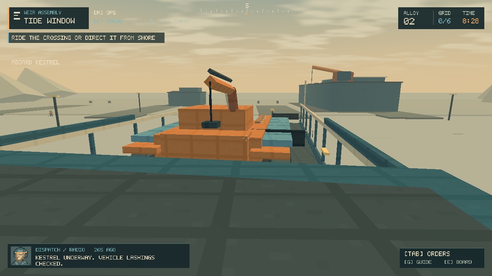

# 1stprts · Orra Basin

Orra Basin is a first-person real-time strategy game about six factions competing over an industrial transport network. You command from wherever you are standing. Watch a mill take its first delivery, ride a crawler aboard a moving ferry, or walk into an 800-metre station while a surface crew keeps working.



## Play

Build with CMake 3.20 or newer and a C11 compiler. The build finds an installed SDL3 or fetches its pinned sources, and fetches Lua 5.4.8. Local source trees can be supplied with `-DORRA_SDL_SOURCE=...` and `-DORRA_LUA_SOURCE=...`.

```sh
cmake -S . -B build -DCMAKE_BUILD_TYPE=Release
cmake --build build --config Release --parallel
./build/bin/1stprts
```

On Windows launch `build/bin/1stprts.exe`. Keep `content.json`, `assets/`, `scripts/` and enabled `mods/` beside the executable. The game opens at Gate Six. Press **M** to choose an operation, or launch `1stprts --mission tide-window`. The headless runner uses the same rules. Run `orra-sim --list` to see the installed operations.

| Control | Action |
| --- | --- |
| WASD, Shift | Walk and run. Click for mouse look, or turn with the arrow keys. |
| E | Use a hatch, change vessels or open a dispatch desk. Walk along the ferry ramp to disembark at a berth. |
| Tab, arrows, Enter | Raise the orders slate, select an order and confirm. Number keys and clickable rows dispatch directly. Page Down turns the page. |
| C, V | Open the crew register or address the crew in sight. Select a crew, use left or right to choose a target, then confirm the assignment. |
| L | Read recent radio messages and their ages. A crew card keeps the coordinates and age of its last field report. |
| M or F2, F1, Escape, R | Choose an operation, open the field guide, lower a panel, or retry a finished operation. |

On a touch-first browser, drag on the left to walk and on the right to look. Tap **Orders** or **Interact** at the bottom right. Tap **Crews** for a crew card. Tap either side of its target line to change the destination. The selected assignment survives rotation.

In WebXR, the left stick walks and the right stick snap-turns. The left trigger raises the slate, the left grip advances its selection, the right trigger confirms and the right grip uses a hatch. Tracked controllers can point at the left-hand slate. Point at the Gate Six switch room and confirm to send an available section. Left X/Y open operations and crews, right B changes the assignment target, and pressing the right stick retries a finished operation.

## Campaign

The six named missions contain **39 unit types, 27 base facilities, three objective structures, six factions and six mission upgrades**. The Compact also has a playable alternate operation at Gate Six. Unit tests check the scene placements against the catalog. [Complete roster](docs/roster.md)

The implementation plan covers repeatable army production, contested resources, crewed interiors across the roster, world targeting and campaign saves. [Implementation checklist](openspec/changes/complete-basin-campaign/tasks.md) · [Milestones and playable acceptance tests](openspec/changes/complete-basin-campaign/design.md)

| Operation | Commander's assignment |
| --- | --- |
| Gate Six | Commission the Plate Mill, haul plate and raise both infantry and armor. Hold the switch room for 60 uninterrupted seconds. The Compact builds its own base and can take the gate. |
| Tide Window | Deliver two power cores before high tide at 12:00. A hoist buys time, a ramp opens a second landing, and a patient skipper can win with all eight alloy unspent. |
| Westbound | Survey the rail line, repair track and move winter freight into the exchange. A charged gallery can keep a priority shift running during an outage. |
| White Mile | Drain a flooded survey camp and return a sample to the assay office. Wide Shoes shorten the loaded hauler's route. |
| Night Mail | Deliver three mailbags before dawn. Patrol and cargo crews share an apron, and the Night Board adds an arrival slot. |
| High Water | Launch a crewed tender, dock with Crown Station and restore traffic control. A second collar lets a transfer overlap tug service. |
| Gate Six / Compact | Sound the shallows, carry the Channel Section across in a Wake, and tow the staffed Slip Shed to a new mooring. |

## Browser build

With Emscripten active, build and serve the web distribution. The HTTP server prints the local address. Immersive WebXR uses HTTPS or localhost.

```sh
emcmake cmake -S . -B build-web -DCMAKE_BUILD_TYPE=Release -DBUILD_TESTING=OFF
cmake --build build-web --parallel
python3 -m http.server 8000 --directory build-web/bin
```

## Mods and verification

The C engine owns rendering, the first-person body, moving reference frames and device input. Lua defines costs, crew assignments, schedules, rivals and victory. The bundled Long Watch pack changes two mission timers, two liveries and a radio cue. [Content and pack API](docs/modding.md)

```sh
ctest --test-dir build -C Release --output-on-failure
openspec validate --all --strict
```

On Linux with GCC, Lua 5.4's `luac`, Python 3 and Node 24, configure with `-DORRA_COVERAGE=ON` and run `python3 tools/coverage.py build`. This collects fresh unit-only profiles and enforces independent 95% source-line gates for native C, shipped Lua including add-ons, and handwritten browser JavaScript. Run `python3 tests/browser.py build-web/bin` with Playwright Chromium for desktop, touch and emulated XR victories.

Set `ORRA_CAPTURE_DIR` to an existing directory, then run `1stprts --mission tide-window --replay tests/ferry-bridge.route` to capture the player's framebuffer. On headless Linux use `SDL_VIDEODRIVER=offscreen SDL_AUDIODRIVER=dummy LIBGL_ALWAYS_SOFTWARE=1`. CI retains diagnostic states and frames from failed rendered runs. [Screenshots](docs/screenshots/README.md) · [Campaign playtest](docs/playtests/campaign/README.md) · [OpenSpec milestones](openspec/changes/define-first-command/tasks.md)

## Licenses

Code, including C, Lua, shaders and build scripts, uses the MIT License. Original models, sprites, textures, bitmap lettering, sound and screenshots use CC BY 4.0. Bundled third-party components retain their notices. [MIT](LICENSE) · [CC BY 4.0](LICENSES/CC-BY-4.0.txt) · [Art credits](assets/CREDITS.md)
