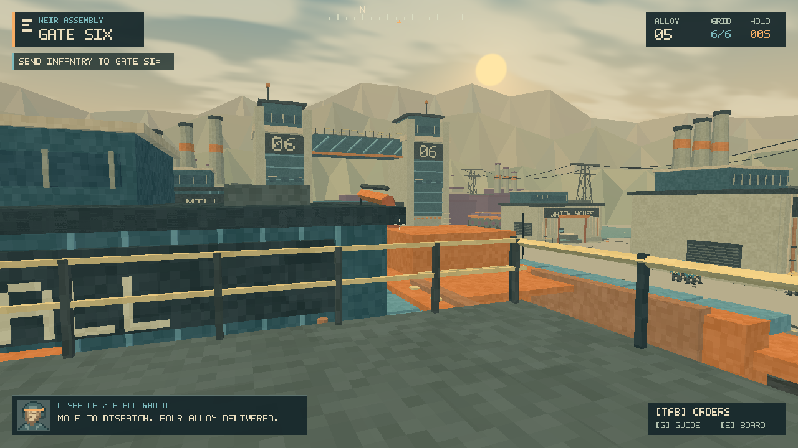

# 1stprts · Orra Basin

**Gate Six is playable.** You command the Weir Assembly from your own eyes. Commission a mill, dispatch a salvage crawler, muster infantry and build a crewed causeway tank. Walk up the survey gantry, visit the dispatch room, or board the Lintel and keep giving orders while its crew drives. A rival base spends its own alloy and can win the same battle.



## Play

Build with CMake 3.20 or newer and a C11 compiler. CMake finds an installed SDL3 or fetches the pinned sources. It also fetches Lua 5.4.8. To build offline, pass local source trees with `-DORRA_SDL_SOURCE=...` and `-DORRA_LUA_SOURCE=...`.

```sh
cmake -S . -B build -DCMAKE_BUILD_TYPE=Release
cmake --build build --config Release --parallel
./build/bin/1stprts
```

On Windows launch `build/bin/1stprts.exe`. Keep `assets/` and `scripts/` beside the executable. In the web build these are separate HTTP resources beside the Wasm module. Edit the Lua campaign roster or mission rules and restart to see changes.

| Control | Action |
| --- | --- |
| WASD / Shift | Walk / run |
| Click and move the mouse, or use arrow keys | Look |
| Tab | Open the command slate. Use arrows and Enter, click a row, or press its number. |
| E | Board at a vehicle's rear hatch, leave it, or use the Survey Hall dispatch desk. |
| G or F1 | Open the field guide. Left/right selects a category, up/down selects an entry. |
| Escape / R | Lower the slate or release the mouse / restart after the result. |

On a touch-first browser, drag the left side to walk, drag the right side to look, and tap the on-screen controls to open the slate, issue orders and board. In supported secure WebXR sessions use the left stick to walk and the right stick to snap-turn. Left trigger opens the slate, left grip cycles its selection, right trigger confirms, and right grip operates the hatch.

**Winning the opening.** Order a Plate Mill and start the hauler. A processed load earns four alloy. A Watch House and Gate Section let you occupy the switch room. A Motor Hall and Lintel let you contest the yard. Lookouts call out the Compact relief party when they spot your infantry crossing. Send armor to support the section and keep the room clear for 60 consecutive seconds. If the Compact takes it, the field notice shows how long you have to recover it. The clock and crews keep moving while a panel is open.

## Scope and content

The editable field guide contains **39 unit types, 30 building or objective types, six factions, six named missions and six upgrades**. Gate Six is the playable mission, with six unit types and six building or objective types represented across two armies. Production uses surveyed, fixed pads and one introductory unit per production queue. The other five missions and the six upgrades are catalog entries for future implementation. [Full roster](docs/roster.md) · [Game concept](docs/concept.md) · [Faction field guide](docs/field-guide.md)

## Browser build

With the Emscripten toolchain active, run the following commands. Open the local URL printed by the HTTP server. A remote deployment needs HTTPS for immersive VR.

```sh
emcmake cmake -S . -B build-web -DCMAKE_BUILD_TYPE=Release -DBUILD_TESTING=OFF
cmake --build build-web --parallel
python3 -m http.server 8000 --directory build-web/bin
```

## Verification and screenshots

```sh
ctest --test-dir build -C Release --output-on-failure
openspec validate --all --strict
```

On Linux with GCC, Lua 5.4's `luac`, Python 3 and Node 24, configure with `-DORRA_COVERAGE=ON` and run `python3 tools/coverage.py build`. The runner collects fresh unit-only profiles, inventories the first-party C and Lua sources, then enforces three independent 95% line gates including browser JavaScript. Run `python3 tests/browser.py build-web/bin` with Playwright Chromium installed for rendered desktop, touch and emulated WebXR checks.

Set `ORRA_CAPTURE_DIR` to an existing directory and run `1stprts --replay tests/gantry.route` or `tests/gate-six.route` for first-person framebuffer captures. On headless Linux set `SDL_VIDEODRIVER=offscreen SDL_AUDIODRIVER=dummy LIBGL_ALWAYS_SOFTWARE=1`. [Screenshot gallery](docs/screenshots/README.md) · [Campaign OpenSpec milestones](openspec/changes/define-first-command/tasks.md)

The Gate Six playtest compares two matched groups of seeds across five commander policies and records rendered feedback, timing and legibility. [Evaluation, captures and reproduction instructions](docs/playtests/gate-six/README.md)

## Licenses

Project code, including C, Lua, shaders and build scripts, uses the [MIT License](LICENSE). Original game art, including models, textures, sprites, sound effects and music, uses [Creative Commons Attribution 4.0 International](LICENSES/CC-BY-4.0.txt). Art packs carry credits with the work, creator, source, license and any modifications. Third-party works retain their own notices.
